<p align="center">
  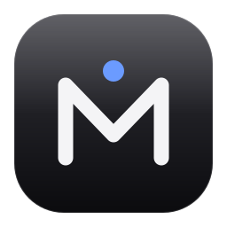
</p>

<h1 align="center">Memora</h1>

<p align="center">
  A complete desktop operating system built on Arch Linux and Hyprland,<br>
  with a unified liquid-glass interface, a native application suite and an integrated AI assistant.
</p>

<p align="center">
  <a href="#overview">Overview</a> &nbsp;|&nbsp;
  <a href="#highlights">Highlights</a> &nbsp;|&nbsp;
  <a href="#screenshots">Screenshots</a> &nbsp;|&nbsp;
  <a href="#architecture">Architecture</a> &nbsp;|&nbsp;
  <a href="#getting-started">Getting started</a> &nbsp;|&nbsp;
  <a href="docs/DEVELOPMENT.md">Development</a>
</p>

<p align="center">
  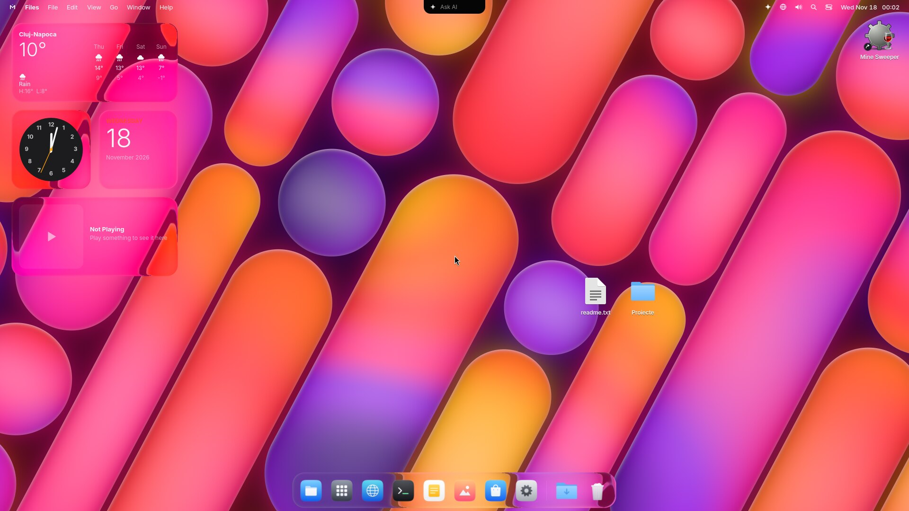
</p>

## Overview

Memora is an operating system for people who want the polish and coherence of a commercial desktop
on an open, rolling Linux foundation. Every visible surface, from the login screen to the menu bar,
the Dock, the widgets and the bundled applications, is part of a single design system and is
developed in this repository.

The project ships as a bootable ISO with a graphical installer. A finished installation provides
an encrypted btrfs system with automatic snapshots, hardware-appropriate graphics drivers, a hardened
default configuration and a desktop that is usable with a mouse, the keyboard alone or touch.

| | |
|---|---|
| **Base** | Arch Linux, rolling release |
| **Compositor** | Hyprland with a custom liquid-glass rendering plugin |
| **Shell** | Quickshell (Qt/QML), developed as part of Memora |
| **Appearance** | Light and dark, Clear or Tinted glass, configurable accent colour |
| **Assistant** | Memora AI, with support for Claude, DeepSeek, Ollama and OpenAI-compatible servers |
| **License** | MIT |

## Highlights

**One consistent interface.** The menu bar, Dock, application library, Control Center, Notification
Center, Spotlight, Mission Control, lock screen and login screen share the same components, spacing,
typography and materials. Light and dark appearances are designed independently rather than inverted.

**Liquid glass, configurable.** Translucent surfaces are rendered by a compositor plugin. Users can
choose Clear or Tinted glass and adjust transparency, frost, colour through glass and edge light, or
turn on Reduce Transparency for maximum legibility.

**Memora AI.** An assistant that lives in a notch at the top of the screen. It can answer questions,
operate the computer on the user's behalf (run commands, manage files and windows, change settings,
read the screen) and process files dropped onto it: format conversion, compression, resizing, PDF
assembly, text extraction and archiving. Every consequential action waits for explicit approval.

**Native applications.** System Settings, Files, Notes, Calendar, Gallery, Music, App Store,
Archives and Activity Monitor are built on the same toolkit as the shell and behave consistently.

**Professional window management.** Edge and corner docking, a layouts bar adapted to the screen
shape (standard, wide, ultrawide, portrait), Snap Assist, shared resize handles, Mission Control with
named desktops, App Expose, Hot Corners and Picture in Picture.

**Multi-display and touch ready.** Extend, mirror or single-screen modes, per-display scaling derived
from pixel density, windows that return to a reconnected display, edge swipes, multi-finger gestures
and an on-screen keyboard for 2-in-1 devices.

**Secure by default.** Firewall enabled from first boot, kernel and network hardening, optional LUKS2
full-disk encryption, snapshots before every system update and signed Memora updates.

## Screenshots

### Desktop

<table>
  <tr>
    <td width="50%"></td>
    <td width="50%"></td>
  </tr>
  <tr>
    <td align="center">Light appearance</td>
    <td align="center">Dark appearance</td>
  </tr>
</table>

Widgets for weather, clocks, calendar, reminders, media, notes, batteries and system status sit on
the desktop in small, medium or large sizes and snap to a grid.

### Memora AI

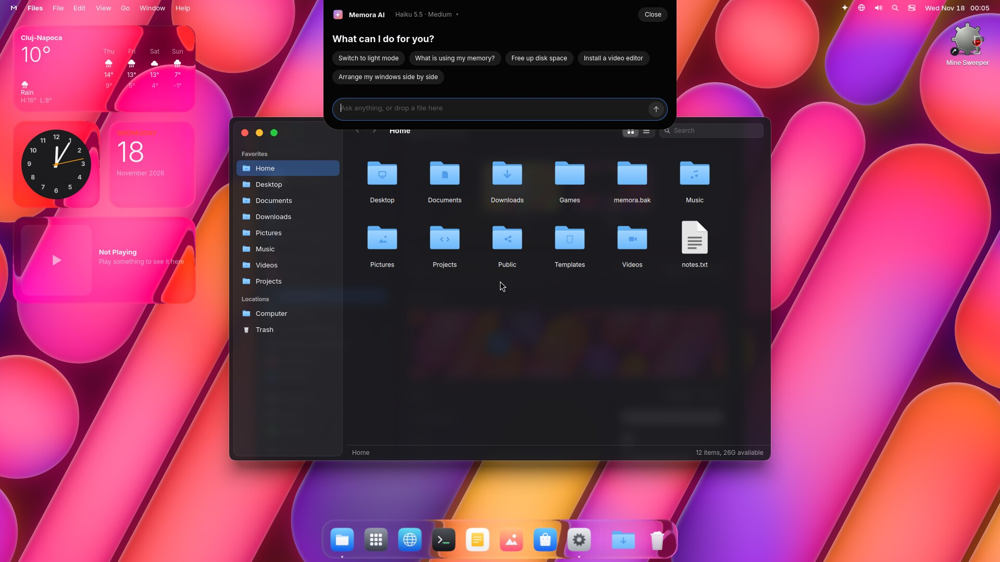

The assistant opens from the notch in the menu bar or with Super+A. It suggests common tasks, accepts
free-form requests and accepts files dragged onto it.

### Applications library and Mission Control

<table>
  <tr>
    <td width="50%">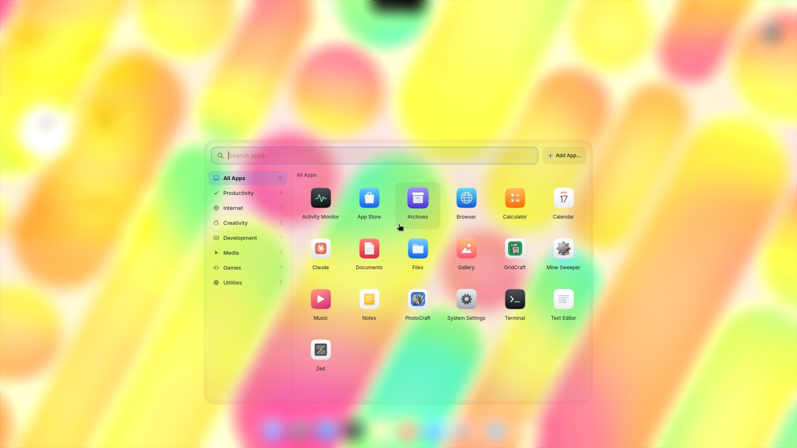</td>
    <td width="50%">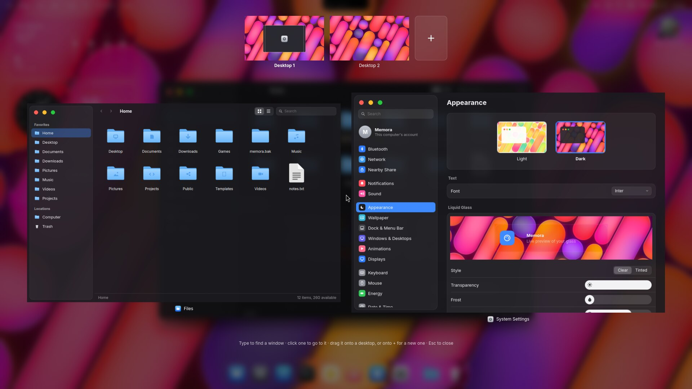</td>
  </tr>
  <tr>
    <td align="center">Applications library with search and categories</td>
    <td align="center">Mission Control with desktops and live windows</td>
  </tr>
</table>

### System Settings and Control Center

<table>
  <tr>
    <td width="50%">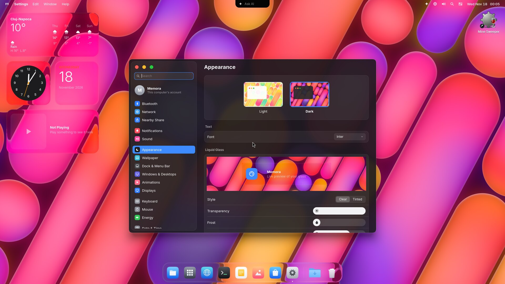</td>
    <td width="50%">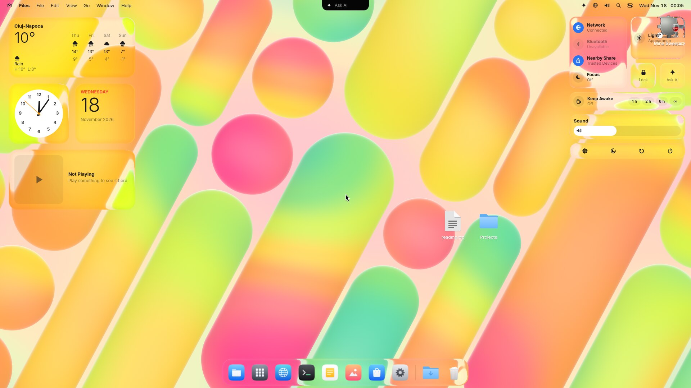</td>
  </tr>
  <tr>
    <td align="center">System Settings, Appearance pane</td>
    <td align="center">Control Center</td>
  </tr>
</table>

### Applications

<table>
  <tr>
    <td width="50%">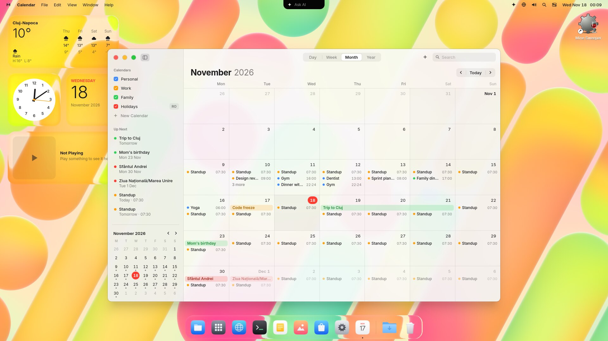</td>
    <td width="50%">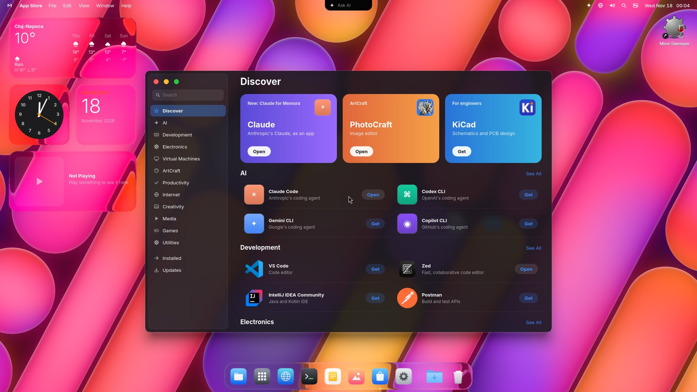</td>
  </tr>
  <tr>
    <td align="center">Calendar with day, week, month and year views</td>
    <td align="center">App Store with curated Flathub software and developer tools</td>
  </tr>
  <tr>
    <td width="50%">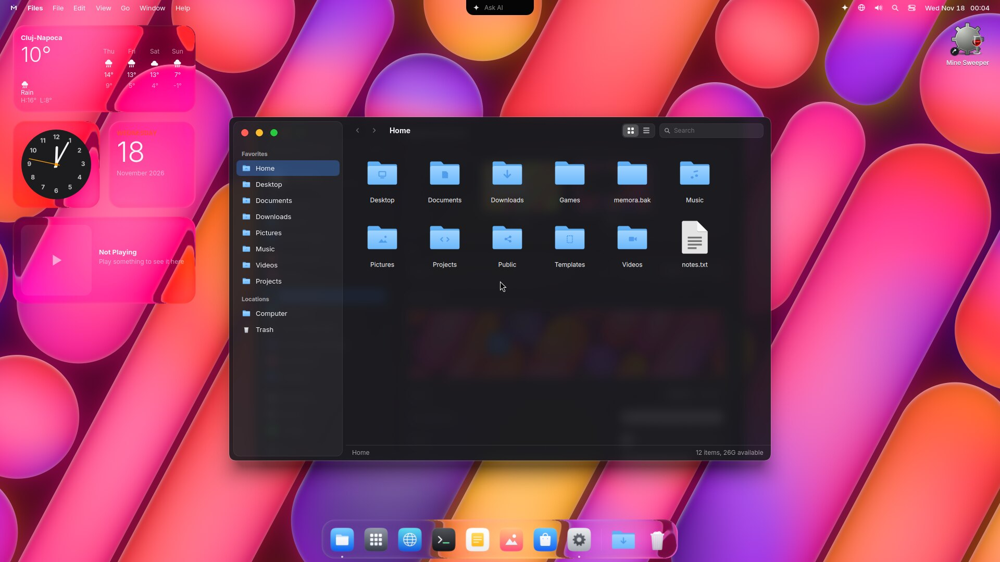</td>
    <td width="50%">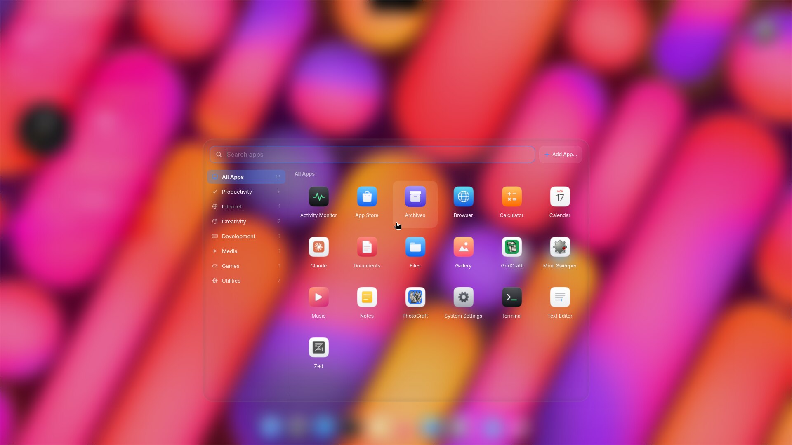</td>
  </tr>
  <tr>
    <td align="center">Files</td>
    <td align="center">Applications library, dark appearance</td>
  </tr>
</table>

## Features

### Desktop shell

| Component | Description |
|---|---|
| Menu bar | System menu, active application name, standard File, Edit, View, Go, Window and Help menus that work in any application, status icons and clock |
| Dock | Pinned and running applications with magnification, launch feedback, minimized windows, Downloads and Trash; bottom, left or right placement with automatic hiding when space is needed |
| Applications library | Searchable library grouped by category, with most-used applications first |
| Spotlight | Applications, files, settings, calculations, clipboard history, keyboard shortcuts and AI queries (Super+Space) |
| Control Center | Wi-Fi, Bluetooth, Focus, appearance, display, sound, media and power |
| Notification Center | Banners and a history view with an integrated calendar |
| Mission Control | All desktops and windows (Super+S or three-finger swipe), window search, named desktops, App Expose |
| App switcher | Application switching with Alt+Tab or Super+Tab, per-application window switching, quit and hide from the switcher |
| Lock and login | A shared design for the lock screen and the login screen, with a seamless transition into the session |
| System dialogs | Administrator authentication (polkit), volume and brightness indicators |

### Applications

| Application | Description |
|---|---|
| System Settings | Network, Bluetooth, Nearby Share, notifications, sound, appearance, wallpaper, Dock and menu bar, windows and desktops, displays, input devices, energy, privacy, updates and reset |
| Files | File manager with sidebar favourites, grid and list views, search and desktop integration |
| Notes | Notes with folders, pinning, formatting and recently deleted items |
| Calendar | Multiple calendars, public holidays by country, natural-language event entry, drag and drop scheduling, reminders |
| Gallery and Music | Photo, video, music and film libraries |
| App Store | Curated Flathub applications, AI coding agents and developer toolchains, installed per user |
| Archives | Opens zip, rar, 7z, tar variants, iso, dmg, cab, msi, deb, rpm, wim and multi-part archives; creates password-protected zip, 7z, RAR and tar archives |
| Activity Monitor | Running processes and system resource usage |
| Terminal | Ghostty with Memora light and dark themes |

### Memora AI

| Provider | Capabilities |
|---|---|
| Claude (Anthropic API) | Full tool use: commands, files, applications, settings, windows, screen reading and input, web search, memory |
| Claude Code | Uses the user's Claude account and its own toolset |
| DeepSeek | Full tool use without web search, through its Anthropic-compatible API |
| Ollama and OpenAI-compatible servers | Conversation only |

Actions with lasting effect, such as administrator commands, deleting or replacing files, installing
software, changing startup items or sending data to another computer, require the user to select
**Allow**. The most destructive operations display a prominent warning first. Administrator commands
are elevated individually through the Memora password dialog.

### Security and updates

- Firewall (ufw) enabled from first boot with no inbound connections allowed.
- Kernel and network hardening, private home directories, remote login disabled by default and
  temporary lock-out after repeated failed passwords.
- Optional LUKS2 full-disk encryption configured by the installer.
- Btrfs snapshots before every package transaction, through snapper and snap-pac.
- Software Update installs system packages, App Store applications and Memora updates with a single
  authentication. Memora updates are installed only when signed by a trusted key.
- Administrator actions from Settings and the App Store are mediated by `memora-admin`, which accepts
  only a fixed vocabulary of operations and presents each one to the user in plain language.

## Architecture

```
build.sh, builder/   ISO build (Docker and archiso)
iso/                 Live ISO overlay: graphical installer, boot configuration
system/              Installed to /usr/share/memora
  shell/             Desktop shell, login, lock screen and applications (QML)
  plugin/            Hyprland plugin for liquid glass and the login transition
  ai/                Memora AI agent
  bin/               Command-line entry points (memora-shell, memora-settings, memora-ai, ...)
  default/hypr/      Hyprland defaults (Lua)
  icons/             Memora icon theme
  themes/            Light and dark themes
  wallpapers/        Wallpaper collection, 8K, light and dark variants
  install/           Post-install configuration run by the installer
test/                QEMU test harness
tools/               Asset generators for icons, logos and wallpapers
```

### Installed system

| Area | Configuration |
|---|---|
| Disk | GPT, 2 GiB EFI partition, btrfs subvolumes (`@`, `@home`, `@log`, `@pkg`, `@snapshots`), optional LUKS2 |
| Boot | systemd-boot, Plymouth, zram swap |
| Login | greetd with the Memora login screen |
| Session | Hyprland through uwsm, Memora shell |
| Graphics | Detected automatically: NVIDIA open driver for Turing and newer, open-source drivers for older NVIDIA, AMD and Intel; hybrid laptops render the desktop on the integrated GPU |
| Gaming (optional) | Steam with Proton, GameMode, MangoHud, ProtonPlus |

## Getting started

### Requirements

- A 64-bit x86 computer with UEFI firmware
- Docker, to build the ISO
- QEMU with KVM, to test in a virtual machine

### Build the ISO

```bash
./build.sh
```

The image is written to `out/memora-<version>-<date>-x86_64.iso`.

### Install

1. Write the ISO to a USB drive with `dd`, Ventoy or a similar tool.
2. Boot the computer from the drive in UEFI mode.
3. Follow the graphical installer: language and keyboard, network, disk and encryption, user account,
   time zone, appearance, optional developer tools and a final review that lists the drivers selected
   for the hardware.

The installer works with a mouse, the keyboard alone or touch, and falls back to a text installer if
the display cannot be initialised.

### Try it in a virtual machine

```bash
test/vm.sh install
```

```bash
test/vm.sh run
```

The default test account is `memora` with the password `memora`. See
[docs/DEVELOPMENT.md](docs/DEVELOPMENT.md) for the full development and testing workflow.

### Personal configuration

Personal Hyprland settings belong in `~/.config/hypr/user.lua`, which is loaded last and is never
overwritten by system updates.

## Contributing

Contributions are welcome. Please read [docs/DEVELOPMENT.md](docs/DEVELOPMENT.md) before opening a
pull request. Every change is expected to be verified on a running Memora desktop, not only through
static checks.

## License

Memora is released under the [MIT License](LICENSE).
